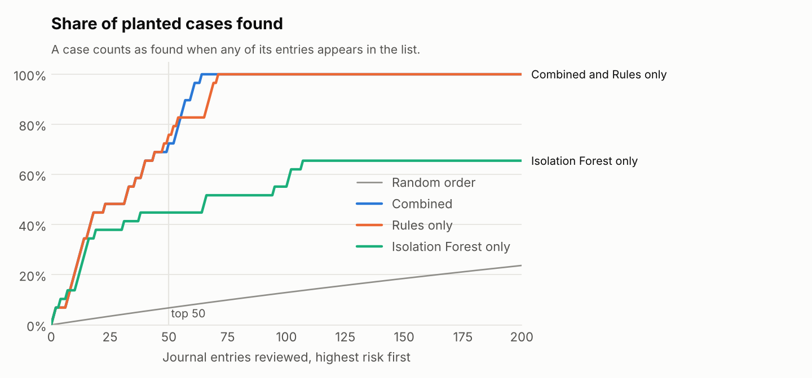
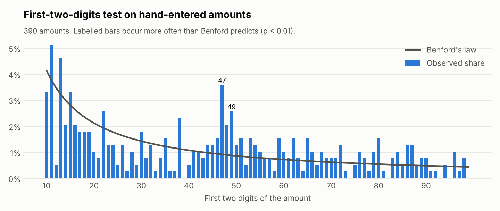
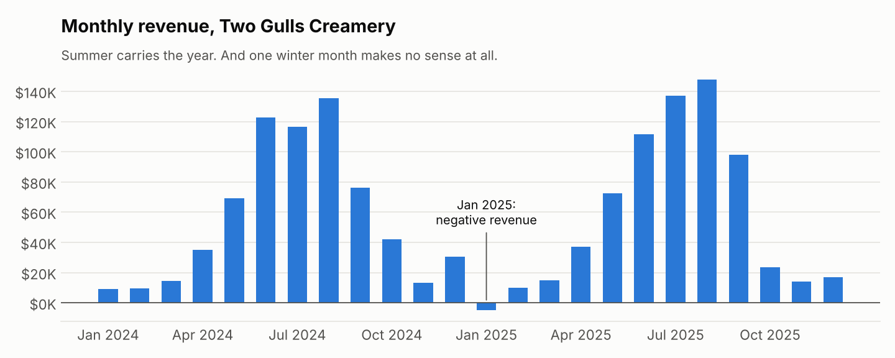

# Which 50 journal entries should the controller look at?

**Journal-entry anomaly detection for a small business ledger, measured against a known answer key.**

A controller or auditor never reviews every journal entry. They review a few dozen, and the real question is *which ones*. This project builds a ranked review list for the books of a fictional ice cream shop, combining the journal-entry tests auditors already use with Benford's law and an Isolation Forest, and then checks how many planted problems the list actually finds.



> **All data is synthetic.** Two Gulls Creamery, its staff, its vendors and every amount are invented. Any resemblance to a real business is coincidental. That is the point: the books are realistic enough to test on, and safe to publish.

## Results

The shop's two years of books hold **1,568 journal entries**, with **29 problems planted** across 65 of them (4.1%). A reviewer works down the ranked list and reviews the top 50, about 3% of the ledger.

Because one ledger has only 29 cases (a single case moves recall by 3.4 points), the whole experiment was repeated on **30 freshly generated ledgers**, with the same rules and weights and no retuning:

| Method | Cases found in top 50 (mean) | Worst ledger | Precision in top 50 (mean) |
|---|---|---|---|
| **Combined** (rules + forest) | **88%** | 79% | 84% |
| Rules only | 81% | 72% | 85% |
| Isolation Forest only | 52% | 45% | 37% |
| Random order | about 7% | | about 4% |

The combined list found more cases than rules alone on 25 of the 30 ledgers, tied on 3 and lost on 2. The ledger in this repo (seed 42) happens to be one of those 2 losses: there the combined list finds 72% of cases in the top 50 against 76% for rules alone, and every case by entry 64. It was the default seed before any result existed, and it stays.

**What the numbers say:** rules written from audit practice do most of the work. The forest is weak on its own, because the costliest problems (duplicate payments, split purchases, a ghost vendor) produce entries shaped exactly like normal bills. Combined, it lifts the borderline cases into the review list more often than not.

## What was planted

| Problem | Cases | What it looks like |
|---|---|---|
| Duplicate payment | 5 | An invoice entered again with its number reformatted (`CBD-6198` as `CBD-6198A`, `PSC-8713` as `PSC8713`) and paid twice |
| Split purchase | 4 | One repair job billed as two invoices just under the $5,000 approval limit |
| Ghost vendor | 1 | A new "supplier" that appears in August 2025, bills just under the limit and is paid within 3 days |
| Period-end revenue | 3 | $15K to $22.5K of catering revenue booked on the last day of a quarter, reversed days later |
| Round-dollar reclass | 4 | Large round cash entries, "Reclass per discussion", approved by their own author |
| Post-close entry | 4 | Entries dated into a closed month, typed 27 to 48 days after month-end |
| Unusual user | 3 | The shift manager, whose job is petty cash, booking "refunds" against the bank account |
| Off-hours entry | 4 | The bookkeeper moving cash out near midnight on a Sunday |
| Personal expense | 1 | The owner's marina slip fee booked as shop repairs |

The answer key lives in `data/anomaly_labels.csv` and is only used for scoring, never for building the list.

## How it works

**1. Journal-entry tests** (`src/detect.py`). Eleven rules, each a plain question with a weight set before any result was checked: 3 for signals that are rarely innocent (duplicate invoice numbers after normalizing their format, entries after the books closed, big entries with no independent approver), 2 for things worth a look (a person posting to an account they almost never use, hand-keyed revenue, a new vendor paid $5,000+ fast, amounts at 90 to 100% of the approval limit), 1 for weak signals (weekend, after hours, round amounts, Benford spikes). Every flag carries its reason, so a reviewer knows what to check.

**2. Benford's law, used carefully.** The first-digit test *fails* for this shop, and that is not evidence of anything. Benford needs amounts spread across several orders of magnitude; a small shop's bills mostly sit between a few hundred and a few thousand dollars, and summer dairy orders repeat at similar levels for weeks. Treating that failure as a finding is the most common misuse of Benford. The first-two-digits test is more useful. After removing mirror entries (payments repeat invoices) and fixed recurring amounts (rent, subscriptions), it singles out **47xx and 49xx**, right under the $5,000 approval limit.



**3. Isolation Forest** (scikit-learn). Features per entry: log amount, entry hour and weekday, days between posting and typing, distance from month-end, person vs. system, source, how often this user posts to these accounts, how common this account combination is, and the vendor's age.

**4. One score.** Rule points plus 3 times the forest's percentile rank, so the most unusual entry in the ledger counts about as much as one strong rule.

Even before any of this, a plain revenue chart already shows something no ice cream shop can explain: **negative revenue in January 2025**, the fingerprint of the year-end revenue that was booked in December and reversed after the new year.



## Run it

```bash
git clone https://github.com/carolmellobee/ice-cream-ledger-anomalies.git
cd ice-cream-ledger-anomalies
python -m venv .venv && source .venv/bin/activate   # Windows: .venv\Scripts\activate
pip install -r requirements.txt

python src/generate_ledger.py   # rebuild the ledger in data/ (seed 42)
python src/detect.py            # print the top of the review list
python src/robustness.py        # repeat on 30 new ledgers (about 30 seconds)
pytest                          # 21 checks: books balance, rule edge cases, reproducibility
jupyter notebook notebooks/ledger_anomaly_detection.ipynb
```

The notebook is saved with its outputs, so it reads fine on GitHub without running anything.

## Repository

```
data/
  journal_entries.csv       one row per journal line (4,543 lines)
  chart_of_accounts.csv
  users.csv
  anomaly_labels.csv        the answer key
src/
  generate_ledger.py        builds the books and plants the problems
  detect.py                 rules, Benford, Isolation Forest, scoring, evaluation
  robustness.py             the 30-ledger experiment
  plots.py                  charts
notebooks/
  ledger_anomaly_detection.ipynb   the full walkthrough
reports/
  figures/                  charts used here
  robustness.csv            per-seed results
tests/
  test_ledger.py
```

## Limits

- **The same author wrote the generator and the detector.** Weights were fixed in advance and never tuned to the labels, but I knew what kinds of problems were planted. Treat these results as evidence that the method works, not as a benchmark. On a real ledger, expect lower precision.
- **Clean data.** Real exports have missing timestamps, shared logins, migrated history and reversed reversals. Getting a real ledger into this shape is most of the work.
- **One-to-one only.** A deposit covering three invoices, or a fraud spread thinly across many small entries, gets past these rules.
- **Engineered features.** The forest's "unsupervised" view still depends on which features it was given.

## Next steps

- Group invoices by vendor and day before testing the approval limit, to catch split purchases directly.
- Check new vendors against employee addresses and bank accounts in the vendor master.
- Score month by month as the books close, so the list arrives while it can still change something.
- Run it on a real, anonymized ledger and measure precision with the people who would work the list.

## Author

**Carol Mello**, data engineer working on finance and accounting data.
[LinkedIn](https://www.linkedin.com/in/carol-mello-0707352b) · [GitHub](https://github.com/carolmellobee) · [Other tools](https://carolmello.vercel.app/)

Licensed under the MIT License.
